<!--
  Profile README for github.com/Arrkkkk
  ─────────────────────────────────────
  Palette   ink #0D1117 · amber #F4B740 (dark) / #9A6700 (light) · text #C9D1D9
  Assets    assets/hero-*.svg     hero banner (dark + light variants, keep in sync)
            assets/icons/*.svg    tech tiles (skillicons.dev style, stored locally)
  Live      GitHub stats, streak and activity graph are fetched on every view.
-->

<picture>
  <source media="(prefers-color-scheme: dark)" srcset="assets/hero-dark.svg">
  <source media="(prefers-color-scheme: light)" srcset="assets/hero-light.svg">
  
</picture>

  <picture>
    <source media="(prefers-color-scheme: dark)" srcset="https://readme-typing-svg.demolab.com?font=JetBrains+Mono&weight=500&size=18&duration=2800&pause=900&color=F4B740&center=true&vCenter=true&width=560&lines=AI+Intern+%C2%B7+Deloitte;Python+%C2%B7+Java+%C2%B7+React+%C2%B7+Flutter;Exploring+cloud+data+with+AWS+%26+Databricks;Open-source+contributor+%C2%B7+GSSoC">
    
  </picture>

  <a href="https://portfolio-fawn-delta-90.vercel.app">Portfolio</a> &nbsp;·&nbsp;
  <a href="https://www.linkedin.com/in/rajit-agrawal-639bab28a/">LinkedIn</a> &nbsp;·&nbsp;
  <a href="mailto:rajitagrawal2005@gmail.com">Email</a>

## `01` About

I'm a Computer Science undergraduate at **VIT Vellore** (B.Tech, class of 2027, CGPA 9.74). Most of what I build sits where software meets finance: market dashboards, a budgeting assistant, and a decentralised quant-trading fund. Finance is a domain where "mostly works" isn't good enough, and that's exactly why I like building for it.

I care about the parts of engineering that make software trustworthy. **MarketPulse** started as a Streamlit app that turned every failure into an empty result, so a rate-limit error showed up as "no news found". I rebuilt it as a layered FastAPI service with typed errors, circuit breakers and caching, backed by 455 tests.

My internships span AI at **Deloitte**, software testing in the capital-markets domain at **AQM Technologies**, and web development at **ApexPlanet**, and I contribute to open source through **GirlScript Summer of Code**. Right now I'm going deeper into applied AI and cloud data platforms.

## `02` Featured work

<table>
  <tr>
    <td colspan="2" valign="top">
      <h3><a href="https://github.com/Arrkkkk/MarketPulse">MarketPulse</a></h3>
      
Real-time stock and crypto dashboard with news aggregation and AI-generated sentiment analysis, built as a FastAPI service behind a thin Streamlit client.

      <ul>
        <li><b>Fails loudly, not silently.</b> Providers raise typed errors (<code>RateLimited</code>, <code>SymbolNotFound</code>, …) that map onto proper HTTP status codes, so an outage is never shown to users as "no data".</li>
        <li><b>Resilient data layer.</b> Retries, a circuit breaker, rate limiting and a memory → SQLite cache that only stores successful responses.</li>
        <li><b>Architecture that can't quietly rot.</b> <code>import-linter</code> contracts enforce the layering in CI; 455 tests at 92% coverage.</li>
      </ul>
      

        <code>Python</code> <code>FastAPI</code> <code>Streamlit</code> <code>Gemini API</code> <code>SQLite</code> <code>Docker</code>
        &nbsp;&nbsp;→&nbsp;<a href="https://github.com/Arrkkkk/MarketPulse"><b>Repository</b></a>
      

    </td>
  </tr>
  <tr>
    <td width="50%" valign="top">
      <h3>QuantChain</h3>
      
A decentralised, AI-driven quant-trading fund that combines machine-learning trading models with blockchain-based fund management.

      
<code>Machine Learning</code> <code>Blockchain</code>

      <!-- TODO: replace with the real link once the repository is public:
           <a href="https://github.com/Arrkkkk/REPO_NAME"><b>Repository</b></a> -->
      
Repository coming soon

    </td>
    <td width="50%" valign="top">
      <h3><a href="https://github.com/Arrkkkk/Multi-AI-Chatbot">Multi AI Chatbot</a></h3>
      
One chat interface for four model providers (Claude, OpenAI, Gemini and Groq). Pick a provider, bring your own API key, and chat.

      
<code>Python</code> <code>Streamlit</code> <code>LLM APIs</code>

      
→&nbsp;<a href="https://github.com/Arrkkkk/Multi-AI-Chatbot"><b>Repository</b></a>

    </td>
  </tr>
  <tr>
    <td width="50%" valign="top">
      <h3><a href="https://github.com/Arrkkkk/Personal-Finance-Tip-Generator-by-Axtech">Personal Finance Tip Generator</a></h3>
      
Enter your monthly income, expenses and savings goal, and Gemini turns them into tailored budgeting advice. Runs entirely in the browser.

      
<code>HTML</code> <code>CSS</code> <code>JavaScript</code> <code>Gemini API</code>

      
→&nbsp;<a href="https://arrkkkk.github.io/Personal-Finance-Tip-Generator-by-Axtech/"><b>Live demo</b></a> &nbsp;·&nbsp; <a href="https://github.com/Arrkkkk/Personal-Finance-Tip-Generator-by-Axtech"><b>Repository</b></a>

    </td>
    <td width="50%" valign="top">
      <h3><a href="https://github.com/Arrkkkk/schedsim">SchedSim</a></h3>
      
Interactive CPU-scheduling simulator: FCFS through MLFQ, with Gantt charts, step-by-step traces, side-by-side comparison and PDF/CSV export.

      
<code>Flutter</code> <code>Dart</code> <code>Riverpod</code>

      
→&nbsp;<a href="https://github.com/Arrkkkk/schedsim"><b>Repository</b></a>

    </td>
  </tr>
</table>

## `03` Tech stack

<table>
  <tr>
    <td width="150"><b>Languages</b></td>
    <td>
      
      
      
      
      
      
    </td>
  </tr>
  <tr>
    <td><b>Frontend &amp; mobile</b></td>
    <td>
      
      
      
      
    </td>
  </tr>
  <tr>
    <td><b>Backend &amp; APIs</b></td>
    <td>
      
      
      
      &nbsp;REST APIs
    </td>
  </tr>
  <tr>
    <td><b>AI &amp; data science</b></td>
    <td>
      
      
      
      
      &nbsp;Generative AI · LLM APIs
    </td>
  </tr>
  <tr>
    <td><b>Cloud &amp; data</b></td>
    <td>
      
      
      &nbsp;Delta Lake · Unity Catalog
    </td>
  </tr>
  <tr>
    <td><b>Databases &amp; tools</b></td>
    <td>
      
      
      
    </td>
  </tr>
</table>

## `04` Experience & credentials

<table>
  <tr>
    <th width="50%" align="left">Experience</th>
    <th width="50%" align="left">Certifications</th>
  </tr>
  <tr>
    <td valign="top">
      <b>AI Intern</b> 
      Deloitte  
      <b>Software Testing Intern</b> 
      AQM Technologies · Capital-markets domain  
      <b>Web Development Intern</b> 
      ApexPlanet Software Pvt. Ltd.  
      <b>Open Source Contributor</b> 
      GirlScript Summer of Code
    </td>
    <td valign="top">
      <b>Generative AI Professional (2025)</b> 
      Oracle Cloud Infrastructure  
      <b>API Fundamentals Student Expert</b> 
      Postman  
      <b>Generative AI using IBM watsonx</b> · <b>Agile Explorer</b> 
      IBM  
      <b>Databricks Fundamentals</b> · <b>AWS Cloud Essentials</b> 
      Databricks · Amazon Web Services
    </td>
  </tr>
  <tr>
    <td colspan="2">
      <b>Honours</b>&nbsp;&nbsp;National Space Hackathon 2025 &nbsp;·&nbsp; VIT Merit Awards &nbsp;·&nbsp; CGPA 9.74 / 10
    </td>
  </tr>
</table>

## `05` GitHub activity

  
  

  

  

## `06` Connect

  
  
  
  
  

Email or LinkedIn is the quickest way to reach me. I'm always glad to talk about software, AI and fintech.
